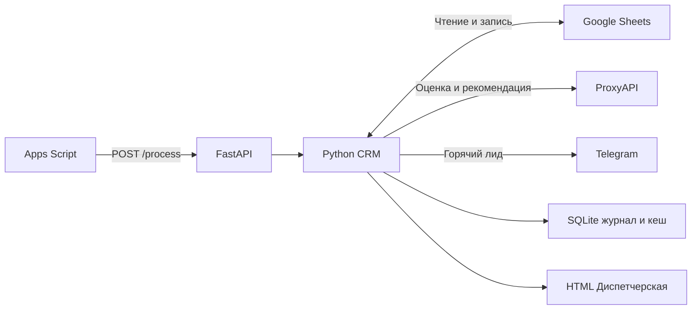

<a id="top"></a>

<div align="center">

# AI Lead CRM

**Заявка в Google Sheets → оценка и следующий шаг → уведомление в Telegram**


[Возможности](#features) · [Быстрый запуск](#quick-start) · [Интеграции](#integrations) · [Архитектура](#architecture) · [Проверка](#checks)

</div>

---

CRM помогает автоматизировать приоритизацию заявок на автоматизацию малого бизнеса. Google Sheets хранит лидов, Python обращается к ProxyAPI за оценкой и рекомендацией, Telegram сообщает о горячих лидах. Google Apps Script запускает обработку по расписанию.

<a id="features"></a>
## Что умеет CRM

| Сценарий | Результат |
|---|---|
| Новая или изменённая активная заявка | AI оценивает источник, бюджет и активность, возвращает балл 0–100 и рекомендацию. |
| Горячий лид | Бот отправляет менеджеру карточку с баллом, бюджетом и следующим шагом. |
| Повторный запуск | Неизменённые оценки используются повторно. Журнал отправок защищает от дублирования уведомлений. |
| Ежедневная работа | «Диспетчерская» показывает очередь, детали выбранной заявки и следующий шаг. |
| Обзор воронки | Dashboard показывает статусы, приоритеты и заявленные бюджеты. |

<a id="quick-start"></a>
## Локальный запуск на Windows

Требуется Python 3.12 или 3.13. В PowerShell из папки проекта:

```powershell
.\SETUP.ps1
.\START-LOCAL.ps1
```

Скрипт создаёт `.venv`, устанавливает зависимости и создаёт `.env` только если файл отсутствует. При запрете PowerShell-скриптов можно выполнить команды вручную:

```powershell
python -m venv .venv
.\.venv\Scripts\python.exe -m pip install -r requirements.lock.txt
Copy-Item .env.example .env  # только если .env ещё нет
.\.venv\Scripts\python.exe -m crm.cli local
```

Локальный режим загружает пример заявок, рассчитывает баллы по правилам и записывает уведомления в файл. Для оценок через AI и отправки в Telegram подключите рабочий режим.

<a id="integrations"></a>
## Подключение рабочего режима

1. Скопируйте `.env.example` в `.env`, если он ещё не создан. Заполните `PROXYAPI_KEY` локально. Ключи не помещайте в GitHub, скринкаст, Apps Script или чат.
2. Создайте сервисный аккаунт Google Cloud, включите Google Sheets API, сохраните JSON как `secrets/google-service-account.json`. Создайте отдельную Google-таблицу для проекта и выдайте её редактирование адресу `client_email` из JSON. Укажите ID таблицы в `GOOGLE_SPREADSHEET_ID`.
3. Запустите `python -m crm.cli init-sheets` через `.venv`. Команда создаёт отсутствующие листы `Лиды` и `Dashboard`, заголовки и выпадающие списки. При несовпадении заголовков существующий лист с лидами не переписывается. Лист Dashboard зарезервирован приложением, не используйте его для ручных данных.
4. Добавьте заявки в `Лиды`. Табличные заголовки и порядок колонок должны соответствовать шаблону `examples/leads.csv`. Ручной ввод — только A:I; колонки J:R заполняет сервис. ID обязателен, уникален и неизменен: латинские буквы, цифры, `_`, `-`.
5. Создайте бота через BotFather. Менеджер должен первым открыть бота и нажать Start; укажите `TELEGRAM_BOT_TOKEN` и `TELEGRAM_CHAT_ID` локально. Эти параметры здесь используются только для отправки, бот не читает переписку.
6. Укажите `CRM_MODE=live`, `LIVE_PROCESSING_ENABLED=true`. Перед этим убедитесь, что разрешаете платные обращения к ProxyAPI. На один запуск разрешено до пяти оценок, SDK не повторяет запрос автоматически. Максимальный ответ — 1600 токенов; стоимость зависит от модели и баланса провайдера.
7. Выполните `python -m crm.cli check`: выводятся только наличие параметров и TCP доступность ProxyAPI. Ключ, токен и содержимое JSON не выводятся. Эта проверка не подтверждает баланс, права или работу модели.
8. Для первой проверки добавьте только одного лида и выполните `python -m crm.cli process`. Проверьте балл, объяснение, рекомендацию, режим оценки в таблице и реальное сообщение менеджеру. Лишь затем включайте расписание.

Команды выше с `python` выполняйте как `.\.venv\Scripts\python.exe`.

## Google Apps Script и HTTPS

Разместите Python сервис на выбранном хостинге с HTTPS и постоянным диском. Автоматический платный деплой проект не выполняет. Команда запуска:

```text
python -m uvicorn crm.api:app --host 0.0.0.0 --port 8000 --workers 1 --no-access-log
```

`GET /health` — только проверка работающего процесса. `POST /process` требует заголовок `X-CRM-Token`. Создайте случайный токен не короче 32 символов, сохраните его в `CRM_TRIGGER_TOKEN` в `.env` сервиса. Не передавайте секрет в URL.

Откройте в таблице Расширения → Apps Script. Вставьте `apps-script/Code.gs`; при необходимости включите отображение манифеста и перенесите `appsscript.json`. В настройках проекта → Script Properties добавьте:

- `CRM_API_URL`: HTTPS адрес сервиса без `/process`;
- `CRM_TRIGGER_TOKEN`: тот же токен, что на сервере.

Один раз запустите `processLeads`, выдайте запрошенные разрешения и проверьте выполнение. Затем вызовите `installTrigger`: запуск каждые пять минут. `removeTrigger` останавливает только триггеры функции `processLeads` этого проекта. В таблице после перезагрузки появится меню CRM.

`CRM_LAST_RUN_UTC`, `CRM_LAST_HTTP_STATUS`, `CRM_LAST_RESULT` в Script Properties показывают последнее выполнение. При ошибках лидов расписание останавливается. HTTP 409 означает, что предыдущий пакет ещё выполняется.

Apps Script не запускает Python внутри Google Sheets: он вызывает Python сервис по HTTPS. Триггер работает от имени создавшего его Google аккаунта. Доступ редакторов к проекту Apps Script должен быть ограничен.

## Схема и оценка

| Колонки ввода | Значения |
|---|---|
| ID, Дата, Имя | Уникальный неизменный ID, дата, название клиента |
| Источник | Рекомендация / Сайт / Telegram / Реклама / Другое |
| Бюджет | Целое число рублей, от 0 до 100 000 000 |
| Контакты за 7 дней | Число обращений клиента, целое 0–1000 |
| Дней без контакта | Целое 0–3650 |
| Ответил | Да / Нет |
| Статус | Новый / В работе / Переговоры / Выигран / Проигран |

Активность вводит менеджер. Автоматическое чтение переписки не предусмотрено. Перед очередной оценкой нужно обновлять относительные показатели активности; сами по себе они не меняются со временем. Дата служит справочной колонкой и в балле не участвует.

В рабочем режиме ProxyAPI получает признаки лида и правила оценки. Модель возвращает балл 0–100, объяснение и рекомендацию. Python проверяет JSON, диапазон и длину полей, затем сохраняет ответ. Локальный режим использует локальные правила. Версия скоринга входит в отпечаток лида, поэтому при первом запуске новой версии прежние активные заявки могут быть обработаны повторно.

Горячий: от `HOT_LEAD_THRESHOLD` (по умолчанию 70); тёплый: 40–69; холодный: 0–39. При снижении порога ниже 40 все баллы ниже порога считаются холодными. В AI запрос уходят только источник, бюджет и числовые показатели активности, без имени, ID или контактов клиента.

AI-балл — приоритет обработки, а не вероятность продажи. Dashboard показывает воронку по статусам, сумму заявленных бюджетов активных лидов, источники и актуальные приоритеты. Сумма бюджетов не является прогнозом выручки. Статистический прогноз потребует истории реальных сделок и отдельной проверки модели.

## Повторная обработка и восстановление

- Источник, бюджет, активность, модель и версия правил входят в fingerprint. Без изменений повторного AI запроса нет. Закрытые сделки пропускаются. Изменение только имени или статуса активной сделки не требует платной переоценки.
- Перед записью результата строка повторно находится по ID и сравнивается с исходными данными. Если она изменилась, запись откладывается. Google Sheets не поддерживает транзакцию между чтением и записью: не сортируйте и не редактируйте лист во время пакета; используйте представления фильтров.
- Успешные ответы дополнительно кешируются на постоянном диске. Сбой записи в Sheets не должен приводить к повторному платному запросу при восстановлении.
- Для горячего лида отправляется одно уведомление на комбинацию ID, fingerprint, порога и чата. Изменение данных горячего лида создаёт новое уведомление. Смена одного только имени — нет.
- SQLite хранит технический журнал отправки и кеш ответов, база лидов остаётся в Google Sheets. Не удаляйте `data/live/state.sqlite`, иначе защита от дублей и кеш пропадут. Делайте резервную копию всего `data/live` при остановленном сервисе.
- При таймауте Telegram неизвестно, дошло ли сообщение. Статус становится «Проверить доставку вручную», автоматической повторной отправки нет. Менеджер проверяет чат и при необходимости отправляет карточку вручную. Гарантировать exactly once для Telegram без идемпотентного API невозможно.
- После ошибки AI строка помечается `SCORING_FAILED`, пакет останавливается. Устраните причину, затем очистите в этой строке `Fingerprint` и `Ошибка` для разрешения ручного повторного запроса. После успешной проверки заново включите расписание.
- Ошибки ответа модели различаются по безопасным кодам: `AI_INCOMPLETE`, `AI_INVALID_RESPONSE`, `AI_EMPTY_CHOICES`. Для диагностики ответы записываются в игнорируемый `data/live/ai_attempts.jsonl`: код, finish_reason, доступные счётчики токенов и ограниченный текст ответа. Журнал предназначен для локального разбора, не для публикации; имена клиентов и секреты в него не включаются.
- Если ответ не получен из-за сетевой или HTTP ошибки, в журнале сохраняются тип ошибки, числовой статус при наличии и типы причин. Для диагностики соединения без генерации: `.venv\Scripts\python.exe tools\check_proxyapi_transport.py`. Скрипт выполняет только GET списка моделей и баланса; сумма баланса и секреты не выводятся, отсутствие разрешения на чтение баланса может давать 403.
- Один экземпляр сервиса, один worker, постоянный диск. Межпроцессная блокировка защищает один каталог данных; несколько независимых серверов не поддерживаются.

<a id="architecture"></a>
## Архитектура



| Каталог | Назначение |
|---|---|
| `crm/` | HTTP API, обработка заявок, AI-скоринг, уведомления и отчёты. |
| `apps-script/` | Меню, проверка подключения и триггер расписания. |
| `examples/` | Примеры строк и заголовков для первоначальной настройки. |
| `tests/`, `tools/` | Тесты и утилиты проверки интеграций. |

<a id="checks"></a>
## Проверка

```powershell
.\.venv\Scripts\python.exe -m pytest -q --basetemp .tmp\pytest
node --test tools\test_apps_script.cjs
.\.venv\Scripts\python.exe -m crm.cli local
.\.venv\Scripts\python.exe -m crm.cli local
```

Тесты проверяют повторный запуск, изменения лида, невалидный ввод, лимит пакета, ошибки модели, неопределённую доставку Telegram, кеш после сбоя записи, защиту от дубля после отправки, авторизацию HTTP и блокировку параллельного запуска. Контракт ProxyAPI проверяется заглушкой без обращения к сети. Это не подтверждение реальной работы сервисов.

`requirements.lock.txt` фиксирует проверенные версии зависимостей; `requirements.txt` задаёт диапазоны для последующего обновления. JavaScript тесты запускаются с Node.js 20+; для работы самой CRM Node.js не требуется.

## Документация

- `docs/Техническое задание.md` — требования и критерии приёмки.
- `docs/Подключение Google и Telegram.md` — настройка интеграций.
- `docs/Apps Script и временный HTTPS.md` — запуск по расписанию.

## Источники технических контрактов

- [ProxyAPI — быстрый старт](https://proxyapi.ru/docs/quickstart): единый `https://api.proxyapi.ru/v1`, идентификатор модели задаётся в `PROXYAPI_MODEL`.
- [gspread](https://docs.gspread.org/en/latest/): сервисный аккаунт, чтение и обновление Google Sheets.
- [python-telegram-bot](https://docs.python-telegram-bot.org/en/stable/): асинхронная отправка сообщения.
- [Устанавливаемые триггеры Apps Script](https://developers.google.com/apps-script/guides/triggers/installable).
- [UrlFetchApp](https://developers.google.com/apps-script/reference/url-fetch/url-fetch-app).
